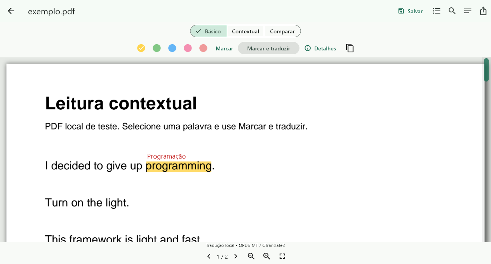

# Entrelinhas

Leitor de PDF com tradução offline de inglês para português, significados acima das palavras e um laboratório para comparar tradução básica e contextual.

[](https://github.com/Joao-AugustoPF/contextual-pdf-reader/actions/workflows/ci.yml)
[](LICENSE)

Abra um PDF local, selecione uma palavra ou expressão e use **Marcar e traduzir**. A tradução aparece em vermelho sobre o trecho marcado. Você também pode escrever o significado, editar, remover marcações e salvar as alterações no próprio PDF no Windows.



## Recursos

- Leitura de PDFs locais, busca, sumário, zoom e barra de rolagem.
- Destaques em cinco cores, seleção por arraste e duplo clique na palavra no desktop.
- Tradução rápida sem abrir um painel a cada seleção; detalhes e comparação disponíveis sob demanda.
- Significados editáveis acima da palavra, com prioridade para a edição manual.
- Salvamento no PDF original no Windows, incluindo edição e remoção, sem duplicar anotações. **Exportar cópia PDF** é opcional.
- Tradução e MiniLM executados localmente após a instalação consentida dos modelos.
- Experimento A/B com decisões, evidências, tempos e relatórios CSV/JSON.

O aplicativo não exige conta, backend ou IA remota. Os modelos são baixados somente por ação explícita. Limites dos SDKs e diagnósticos estão descritos em [Privacidade](docs/PRIVACIDADE.md).

## Estado das plataformas

| Plataforma | Estado verificado | Salvar no PDF original |
|---|---|---|
| Windows | Release compilada, testes de interface e inferência real executados | Implementado e testado |
| Android | Integração e inferência testadas em emulador; release ARM64 compilada | Ainda usa exportação pelo seletor |
| iPhone / iPad | Projeto, integração nativa e testes preparados; falta compilar e testar no macOS e nos aparelhos | Implementado nos fontes; validação nativa pendente |
| macOS / Linux | Projetos incluídos; aplicação não validada nessas plataformas | Sem validação |

Mínimos configurados: Android API 24, iOS/iPadOS 16 e macOS 14. A existência de fontes para uma plataforma não significa que sua distribuição esteja pronta.

## Começar pelo Windows

### Requisitos

- Git e **Flutter 3.47.7 stable**, com Dart 3.13.5, no `PATH`.
- Python **3.12**, com suporte a ambientes virtuais.
- Visual Studio com a carga **Desenvolvimento para desktop com C++** e Windows SDK.
- **Modo de Desenvolvedor** do Windows habilitado para os links simbólicos dos plugins. Abra as configurações com `Start-Process ms-settings:developers`.

As versões usadas nas medições são registradas nos [resultados](docs/TESTES_E_RESULTADOS.md). Evite atualizar dependências antes de reproduzir a versão fixada.

### Clonar e preparar

No PowerShell:

```powershell
git clone https://github.com/Joao-AugustoPF/contextual-pdf-reader.git
cd contextual-pdf-reader
flutter doctor -v
python -m venv .venv
.\.venv\Scripts\python.exe -m pip install -r ml\requirements.lock.txt
cd app
flutter pub get
cd ..
```

### Criar e abrir o aplicativo desktop

Na raiz do projeto:

```powershell
.\scripts\package_windows.ps1
.\app\build\windows\x64\runner\Release\contextual_pdf_reader.exe
```

O script empacota o motor Python com PyInstaller, compila o Flutter e coloca o motor na pasta `runtime` do bundle. Para transportar o aplicativo, copie **toda a pasta `Release`**, incluindo `data`, DLLs e `runtime`. O `.exe` sozinho não basta. O computador de destino não precisa de Python global.

Os SDKs, executáveis compilados e modelos não fazem parte do Git. Este repositório contém os fontes, dependências fixadas, scripts e evidências de teste; não oferece um instalador Windows ou IPA assinado pronto.

### Instalar os modelos e testar

1. Abra **Preferências** e instale **CTranslate2 / Argos • inglês → português brasileiro** por **Baixar com consentimento**. Aguarde **Disponível**.
2. Para **Contextual** e **Comparar**, instale também MiniLM. O modo Básico funciona sem ele.
3. Abra **Experimentar com um PDF**, selecione uma palavra e clique em **Marcar e traduzir**. Use **Escrever significado** para anotar sem modelos.
4. Clique em **Salvar** ou pressione **Ctrl+S**. Abra o mesmo PDF em outro leitor para conferir as anotações nativas.
5. Edite ou remova uma marcação, salve e reabra. Depois da instalação dos modelos, repita a tradução sem rede.

As edições ficam no banco local durante o trabalho; **Salvar** grava no PDF. Remover uma seleção parcial de um destaque remove a marcação inteira e seu significado associado. Há **Desfazer** para a remoção.

O app verifica se o arquivo foi alterado externamente antes de sobrescrevê-lo. PDFs de importações antigas podem pedir a seleção do original uma vez. As anotações geradas pelo Entrelinhas são identificadas para atualizar/remover apenas as próprias marcações.

**Erro `Modelo não instalado: ...translator/metadata.json`:** instale o pacote completo em Preferências. O aplicativo distribuído usa `%APPDATA%\br.com.estudos\contextual_pdf_reader\models`; ter modelos na pasta de desenvolvimento não os instala para o executável.

### Executar em desenvolvimento

Se quiser usar a venv e os modelos da raiz, faça o download explicitamente e informe a raiz absoluta ao Flutter:

```powershell
# Download explícito dos modelos; necessário somente para este caminho de desenvolvimento.
.\.venv\Scripts\python.exe ml\scripts\download_models.py --consent
$readerRoot = (Get-Location).Path.Replace('\', '/')
cd app
flutter run -d windows --dart-define="READER_ROOT=$readerRoot"
```

O download desktop medido foi de aproximadamente 90 MB; a instalação dos modelos ocupa aproximadamente 107 MB. [Artefatos, fontes e hashes](docs/MODELOS_OFFLINE.md).

## iPhone e iPad

Seu amigo pode clonar este repositório no Mac e seguir [Compilar no Mac e instalar no iPhone/iPad](docs/COMPILAR_IPHONE_IPAD.md). O guia cobre Xcode, assinatura, instalação direta e TestFlight.

Sem Mac próprio, use [Build iOS na nuvem](docs/BUILD_IOS_NUVEM.md). O `codemagic.yaml` da raiz inclui os fluxos manuais `ios-verificar` e `ios-testflight`. A compilação continua ocorrendo em macOS/Xcode no serviço. Contas, assinatura e credenciais Apple precisam ser configuradas fora do Git.

O código iOS abre pelo app Arquivos em modo de edição do original e salva com bookmark de autorização e escrita coordenada. **Essa implementação ainda não foi compilada ou executada no iOS.** É necessário testar arquivos locais, iCloud e outros provedores, permissões e conflitos nos dois aparelhos. Não há sincronização própria entre dispositivos.

Para gerar um ZIP dos fontes:

```powershell
python scripts\package_ios_sources.py
```

O arquivo é criado em `dist/contextual-pdf-reader-ios-fontes.zip`; não inclui PDFs pessoais, banco, modelos, SDKs ou credenciais.

## Android

Com o SDK Android e um aparelho/emulador disponível:

```powershell
cd app
flutter pub get
flutter devices
flutter run -d ID_DO_DISPOSITIVO
```

Substitua o ID pelo retornado por `flutter devices`. Em Preferências, instale os pacotes de tradução **ML Kit** de inglês/português e, opcionalmente, MiniLM. O mobile usa ML Kit, não o modelo CTranslate2 do Windows. No Android, use **Exportar cópia PDF** para gravar o documento anotado.

## Básico, Contextual e Comparar

| Modo | Funcionamento |
|---|---|
| **Básico (A)** | Tradução local, expressões e candidatos lexicais. Abstém quando falta uma âncora única. Não carrega/invoca o encoder. |
| **Contextual (B)** | Mesma entrada e candidatos, acrescidos dos tokens MiniLM/ONNX comparados a protótipos contextuais. Experimental; cosseno não é probabilidade. |
| **Comparar** | Compartilha uma tradução de frase e mostra decisões, evidências e tempos dos dois modos. |

No caminho rápido do Básico, palavras fora do léxico são traduzidas isoladamente. No Contextual, quando falta um resultado lexical curto, a sugestão tenta extrair a forma literal usada na frase traduzida, preservando a flexão. Por exemplo, `components often nest` resultou em **aninham**, enquanto `a nest` manteve **ninho**.

Essa extração é heurística. Quando não encontra um trecho adequado, pode usar a tradução isolada, que pode perder o sentido. Edições manuais têm prioridade. O recurso de sugestão da leitura não modifica o experimento do Laboratório nem transforma sugestões em acertos contextuais medidos.

### Resultados A/B medidos

Corpus de **64 exemplos rotulados pelo agente**, sem validação humana independente. Tradução curta correta inclui as abstenções esperadas.

| Ambiente / métrica | A | B |
|---|---:|---:|
| Windows / acertos curtos | 35/64 (54,69%) | 43/64 (67,19%) |
| Windows / decisão adicional p50 | 0,085 ms | 55,166 ms |
| Android emulador / acertos curtos | 34/64 (53,12%) | 43/64 (67,19%) |
| Android emulador / decisão adicional p50 | 0,147 ms | 69,080 ms |

São medições deste corpus e ambiente, não uma promessa de acurácia para qualquer palavra. Os tempos excluem a tradução compartilhada; o primeiro carregamento do encoder custa segundos. Relatórios, perdas históricas, memória, metodologia e limitações estão em [Testes e resultados](docs/TESTES_E_RESULTADOS.md) e [Experimento A/B](docs/EXPERIMENTO_AB.md).

## Testes e reprodução

Na raiz, com o Flutter no `PATH`:

```powershell
cd app
flutter pub get
flutter analyze
cd ..\packages\validation
flutter pub get
flutter test --reporter expanded
cd ..\..
```

Última verificação local: **56 testes compartilhados aprovados**, análise estática sem problemas e **5 testes Python com modelos reais aprovados**. Os testes compartilhados usam o código da aplicação sem exigir os hooks nativos PDFium do host.

Para os testes Python, instale primeiro as dependências e modelos pelo procedimento de desenvolvimento:

```powershell
.\.venv\Scripts\python.exe -m pytest ml\tests -q
```

O teste do processo empacotado é pulado se `dist/reader-runtime/reader-runtime.exe` não existir. Para reproduzir o benchmark desktop, após `flutter pub get` em `app` e a instalação explícita dos modelos:

```powershell
cd app
dart --packages=.dart_tool/package_config.json tool/benchmark.dart ..
```

O comando executa o pipeline Dart com CTranslate2 e ONNX reais e grava `reports/benchmark.json` e `.csv`. O sidecar bloqueia conexões de rede durante a inferência.

Os testes de interface estão em `app/integration_test`. No Windows, execute um alvo por vez, com o bundle/motor preparado. Exemplo a partir da raiz:

```powershell
$readerRoot = (Get-Location).Path.Replace('\', '/')
cd app
flutter test integration_test/reader_contextual_label_test.dart -d windows --dart-define="TEST_PROJECT_ROOT=$readerRoot" --dart-define="TEST_REPORT_DIR=$readerRoot/reports"
```

O GitHub Actions executa análise Dart e testes compartilhados, sem baixar modelos. Ele não substitui as integrações com motores reais, os testes nativos iOS ou a validação em aparelhos físicos.

## Estrutura e documentação

| Caminho | Conteúdo |
|---|---|
| `app/` | Interface Flutter, projetos nativos, assets, testes e ferramentas Dart |
| `ml/` | Sidecar Python, dependências, manifest de modelos e avaliação |
| `packages/validation/` | Testes compartilhados sem dependência do renderizador nativo |
| `scripts/` | Empacotamento, PDFs de teste e ferramentas de verificação |
| `reports/` e `output/pdf/` | Evidências de execução e PDFs de teste |
| `docs/` | Arquitetura, decisões, plataformas, modelos, privacidade e resultados |

- [Arquitetura](docs/ARQUITETURA.md) e [decisões técnicas](docs/DECISOES_TECNICAS.md)
- [Limitações técnicas](docs/LIMITACOES.md) e [salvamento/exportação PDF](docs/EXPORTACAO_PDF.md)
- [Privacidade](docs/PRIVACIDADE.md), [modelos offline](docs/MODELOS_OFFLINE.md) e [licenças de terceiros](docs/LICENCAS.md)
- [Plano e histórico de implementação](IMPLEMENTATION_PLAN.md)
- [Como contribuir](CONTRIBUTING.md)

## Licença

Código da aplicação sob [MIT](LICENSE). Modelos, SDKs, vocabulário e marcas mantêm suas próprias licenças e condições, descritas em [Licenças e atribuição](docs/LICENCAS.md).